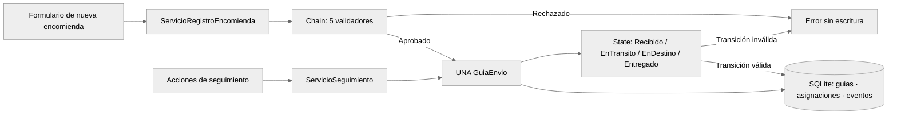

# Arquitectura de tres capas — correspondencia entre código y UML

**Criterio:** una única aplicación Flask organizada en tres capas: Presentación, Aplicación (negocio y dominio) y Datos. Las vistas HTTP dependen de los casos de uso; estos utilizan entidades y contratos; los repositorios implementan dichos contratos para SQLite. No se presenta MVC como arquitectura principal.

```mermaid
%%{init: {"theme": "neutral"}}%%
flowchart TB
    subgraph P["CAPA 1 · PRESENTACIÓN"]
      V["Vista: templates/ · static/"]
      C["Controladores HTTP: rutas.py · operaciones_anteriores.py"]
      V --> C
    end
    subgraph N["CAPA 2 · APLICACIÓN / NEGOCIO"]
      S["Casos de uso: aplicacion/casos_uso/"]
      E["Entidades: aplicacion/dominio/entidades/"]
      A["Chain: aplicacion/dominio/patrones/cadena/"]
      B["State: aplicacion/dominio/patrones/estado/"]
      I["Puertos / interfaces: aplicacion/puertos/"]
      S --> E
      S --> A
      S --> B
      S --> I
    end
    subgraph D["CAPA 3 · DATOS"]
      R["Repositorios: datos/repositorios/"]
      SQL[("SQLite: esquema.sql")]
      R --> SQL
    end
    C --> S
    I <|.. R
```

## Regla de una clase por archivo

| Responsabilidad | Directorio | Clases reales |
| --- | --- | --- |
| Entidades del negocio | `aplicacion/dominio/entidades/` | `GuiaEnvio`, `Viaje`, `Venta`, `Empleado`, `SolicitudRegistro`, `PoliticaPaquete`, `ContextoRegistro`, `ContextoSeguimiento`, `PasoValidacion`, `ResultadoValidacion`, `Receptor` |
| Patrón Chain | `aplicacion/dominio/patrones/cadena/` | `ValidadorEnvio`, `ValidarPersonas`, `ValidarPaquete`, `ValidarTrayecto`, `ValidarPago`, `ValidarCapacidad` |
| Patrón State | `aplicacion/dominio/patrones/estado/` | `EstadoEnvio`, `Recibido`, `EnTransito`, `EnDestino`, `Entregado` |
| Servicios de aplicación | `aplicacion/casos_uso/` | `ServicioAcceso`, `ServicioRegistroEncomienda`, `ServicioSeguimiento`, `ServicioViajes`, `ServicioConsultas`, `ServicioOperaciones`, `ProgramacionViaje`, `RegistroPago`, `RegistroConfirmado` |
| Contratos (puertos) | `aplicacion/puertos/` | `RepositorioGuias`, `RepositorioViajes`, `RepositorioVentas`, `RepositorioAsignaciones`, `RepositorioEventos`, `UnidadTrabajo` |
| Datos (adaptadores) | `datos/repositorios/` | `SqliteGuias`, `SqliteViajes`, `SqliteVentas`, `SqliteAsignaciones`, `SqliteEventos`, `SqliteEmpleados`, `ConsultasSqlite`, `UnidadTrabajoSqlite`, `RepositorioOperacionesSqlite` |

La ruta de cada archivo corresponde al nombre de la clase en *snake_case* (por ejemplo, `ServicioSeguimiento` está definido en `aplicacion/casos_uso/servicio_seguimiento.py`). Hay archivos funcionales sin clases (por ejemplo, rutas Flask, utilidades, fábrica de la cadena, inicialización SQLite).

**Las fachadas `aplicacion/dominio/modelos.py`, `aplicacion/dominio/cadena.py`, `aplicacion/dominio/estados.py`, `aplicacion/servicios.py`, `aplicacion/contratos.py` y `datos/sqlite.py` ya no contienen definiciones de clases.** Exportan las mismas clases desde su nueva ubicación para no romper las pruebas ni las rutas antiguas.

## Dependencias permitidas

1. **Presentación → aplicación**: controladores Flask traducen peticiones HTTP a llamadas de servicio, sin SQL.
2. **Aplicación → dominio y puertos internos**: servicios coordinan reglas, Chain, State y transacciones a través de `UnidadTrabajo`.
3. **Datos → puertos y entidades**: adaptadores SQLite implementan los contratos, reconstruyen guías y guardan eventos.
4. **Dominio** no debe importar Flask, Jinja ni SQLite. Los validadores y estados son clases de negocio.

## Cómo coexisten los patrones



- **Chain of Responsibility** termina al validar el registro. No modifica los objetos persistentes.
- **State** recibe la guía creada y permite únicamente operaciones propias de su estado.
- Los dos comparten `GuiaEnvio.id`, `Viaje`, `Venta`, los servicios de negocio y los repositorios.
- **Iterator y Memento** están diseñados en los diagramas del documento principal, pero no tienen clases ejecutables; se respeta el requisito de implementar solamente dos.

## Diagramas de clases y actividades

Ver [`docs/DIAGRAMAS_UML.md`](DIAGRAMAS_UML.md). Sus clases implementadas se pueden localizar siguiendo el mapa anterior. Los diagramas de Iterator y Memento son *diseños futuros*, por lo que no se deben presentar como código ejecutado.

## Comprobación automática

`tests/test_arquitectura_tres_capas.py` comprueba que cada archivo Python contiene como máximo una definición de clase, verifica los módulos reales de los dos patrones y confirma que las fachadas importan las mismas clases, no copias.

Ejecutar `python -m pytest -q`. El flujo CI de GitHub debe pasar antes de integrar la rama a `main`.
