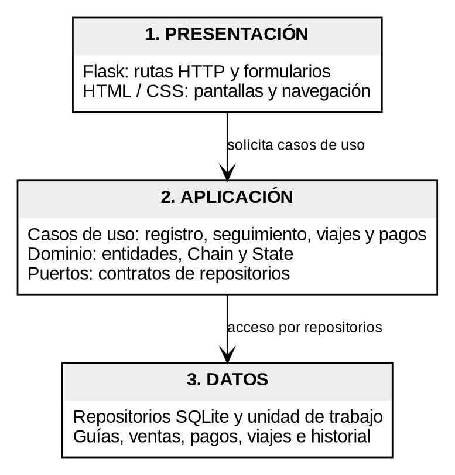
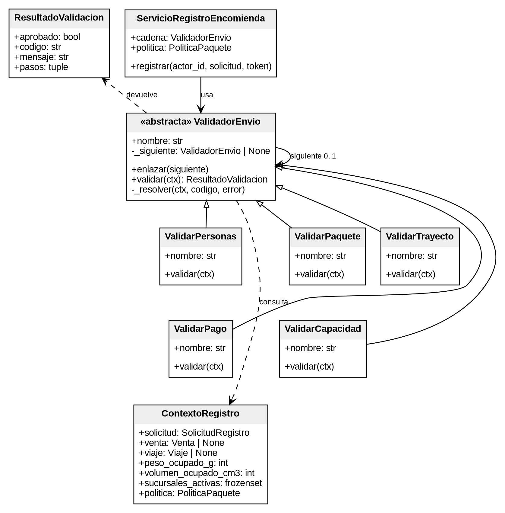
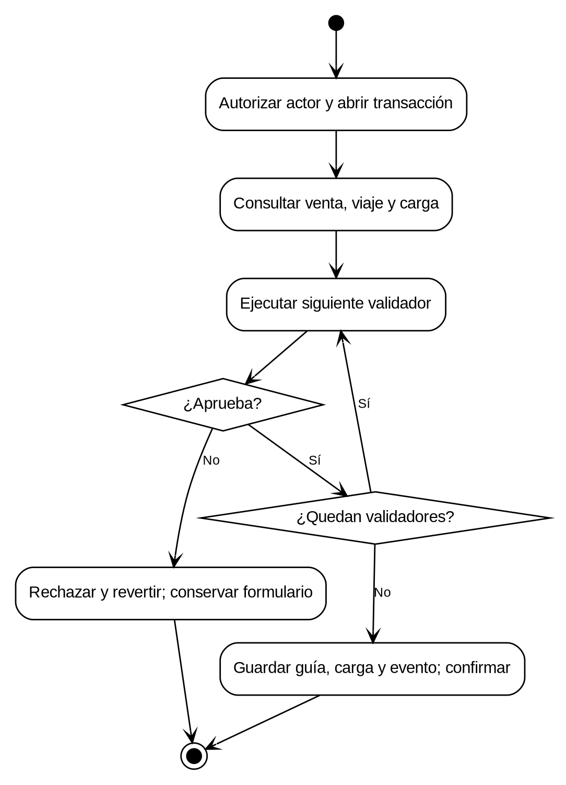
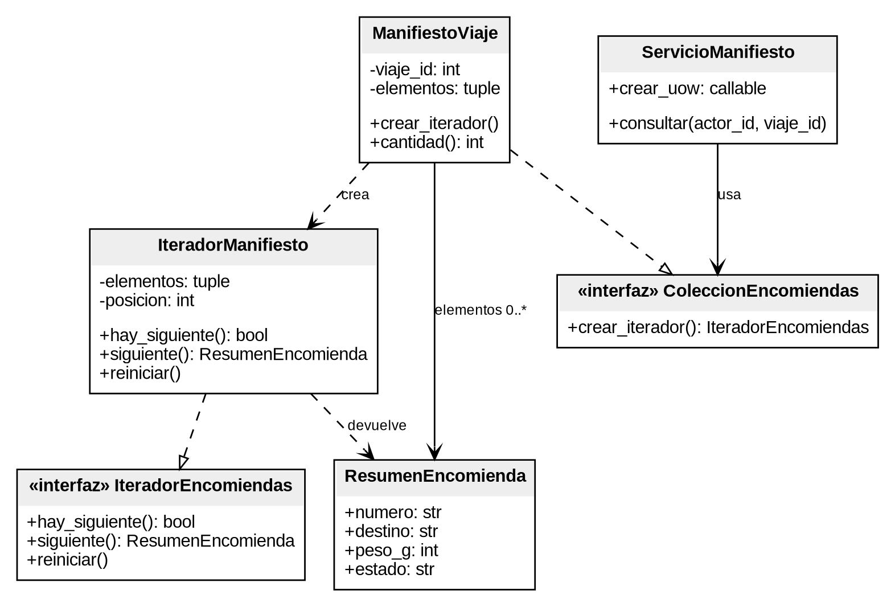
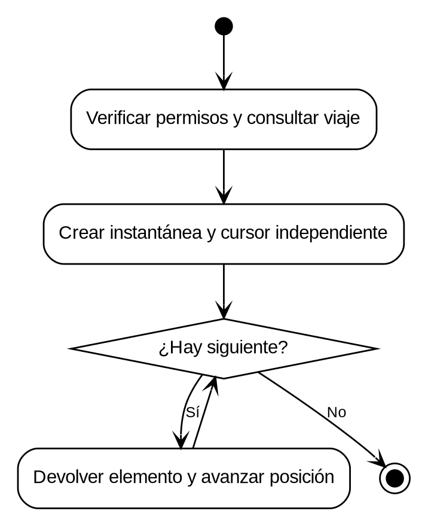
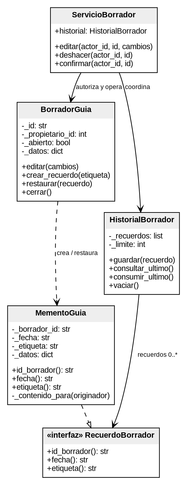
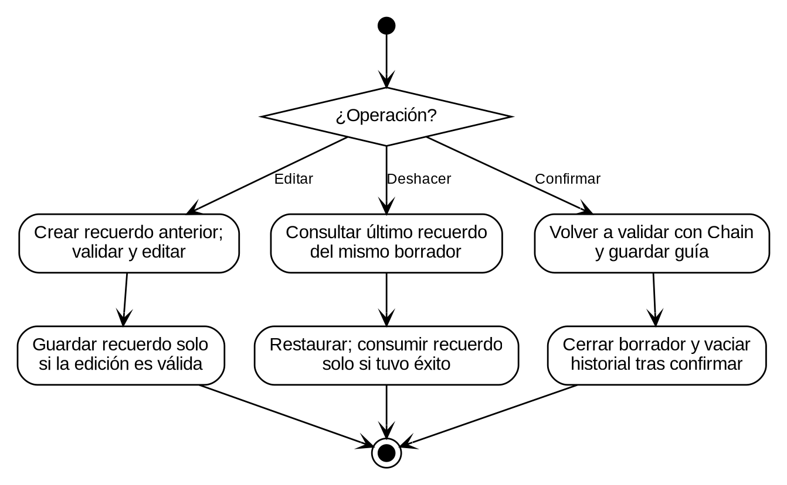
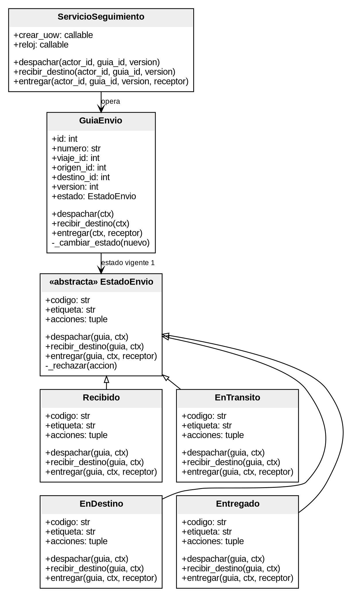
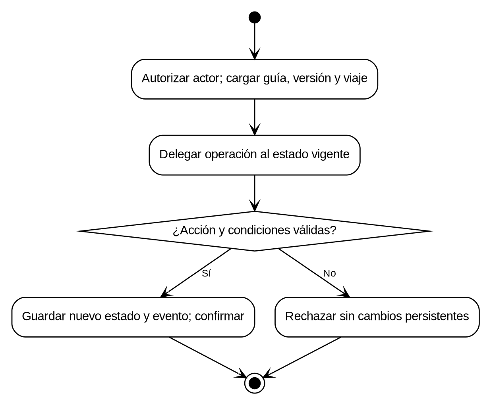
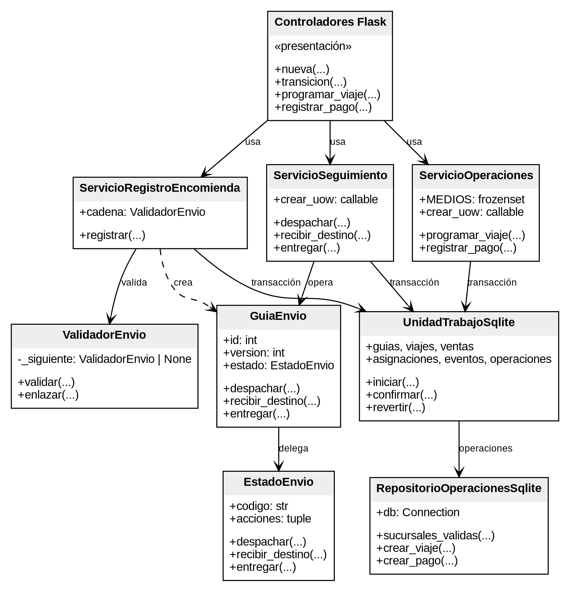

# Diagramas del sistema de transporte y encomiendas

Estos diagramas corresponden al diseño acordado en el [documento del equipo](https://docs.google.com/document/d/1aDlwLGvMw2h4vKJHuKy54kFkoZLg98V4q0_RXPLsd7E/edit). La aplicación implementa Chain of Responsibility y State. Iterator y Memento son propuestas de diseño, sin ejecución.

Los archivos `.dot` junto a cada imagen contienen su fuente editable en Graphviz. Los atributos y métodos de las clases implementadas mantienen los nombres del código Python.

## Figura 1. Arquitectura de tres capas

[Fuente editable](diagramas/01_arquitectura.dot)

## Figura 2. Chain of Responsibility: clases

[Fuente editable](diagramas/02_chain.dot)

## Figura 3. Chain of Responsibility: actividades

[Fuente editable](diagramas/03_actividad_chain.dot)

## Figura 4. Iterator: clases (solo diseño)

[Fuente editable](diagramas/04_iterator.dot)

## Figura 5. Iterator: actividades (solo diseño)

[Fuente editable](diagramas/05_actividad_iterator.dot)

## Figura 6. Memento: clases (solo diseño)

[Fuente editable](diagramas/06_memento.dot)

## Figura 7. Memento: actividades (solo diseño)

[Fuente editable](diagramas/07_actividad_memento.dot)

## Figura 8. State: clases

[Fuente editable](diagramas/08_state.dot)

## Figura 9. State: actividades

[Fuente editable](diagramas/09_actividad_state.dot)

## Figura 10. Integración de viajes, pagos y encomiendas

[Fuente editable](diagramas/10_integracion.dot)

## Convenciones

El triángulo vacío con línea continua representa herencia; con línea discontinua, realización de una interfaz. `+` identifica miembros públicos y `-` miembros internos. En Python, `_` expresa una convención de uso interno. Los diagramas generales omiten detalles incluidos en las figuras de cada patrón.

La interfaz organiza Inicio, Transporte, Ventas y pagos y Encomiendas. Sus formularios convierten kg, m³ y COP a las unidades enteras que reciben los casos de uso; las reglas y las transacciones se conservan en la capa de aplicación.
