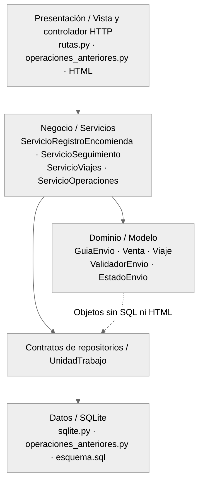
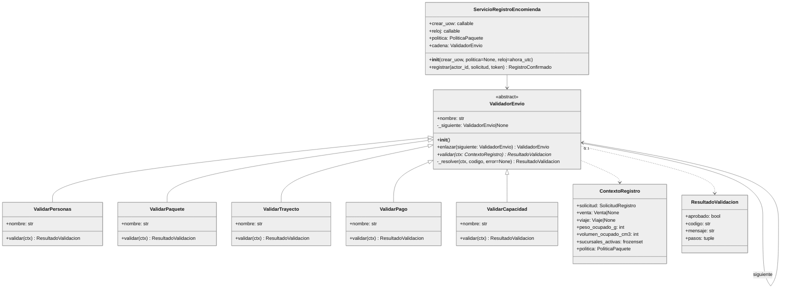
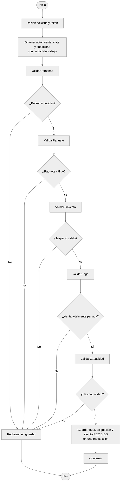
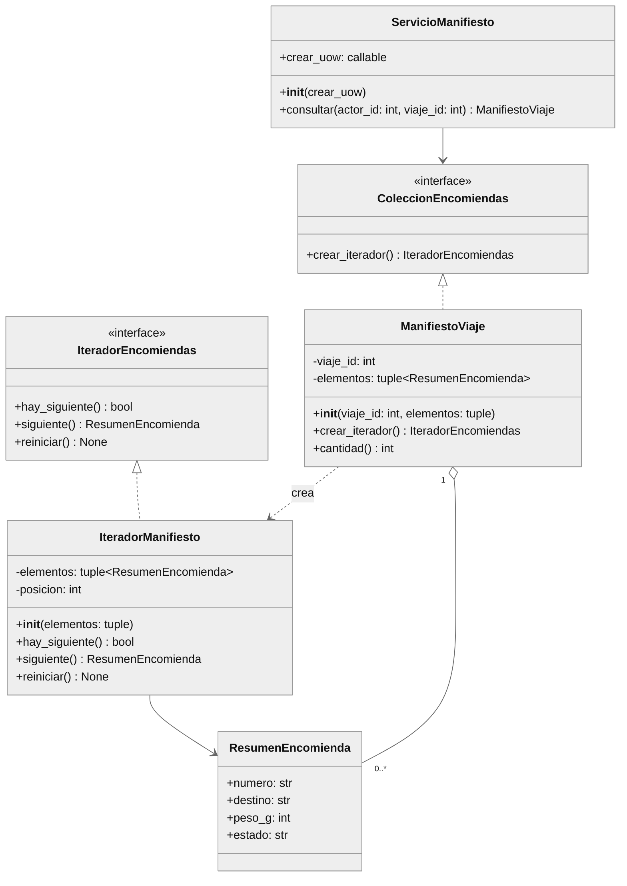
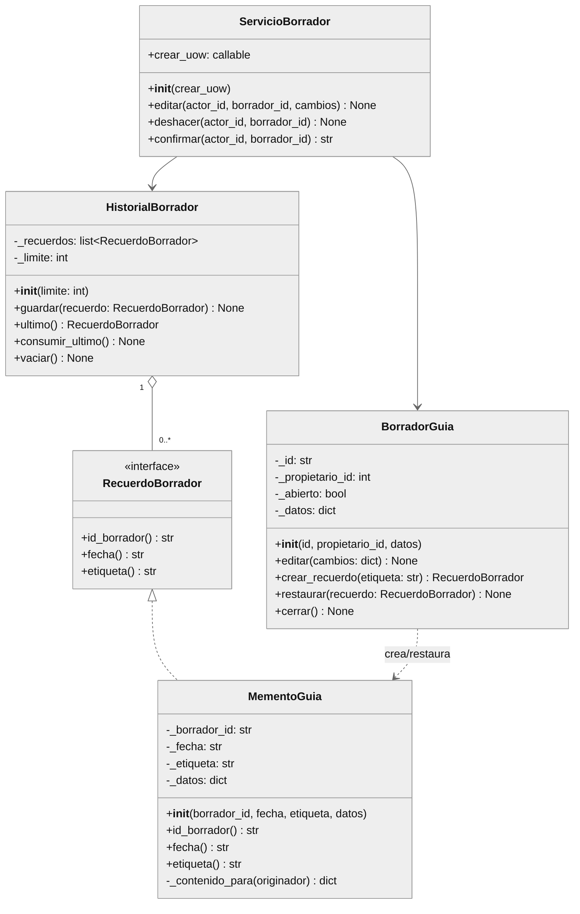
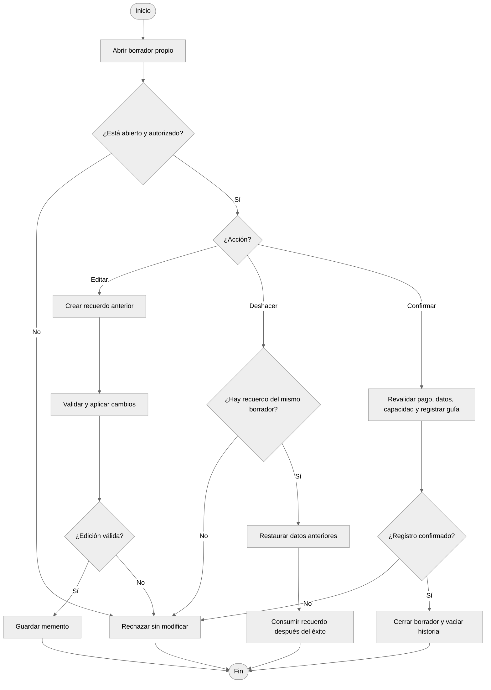
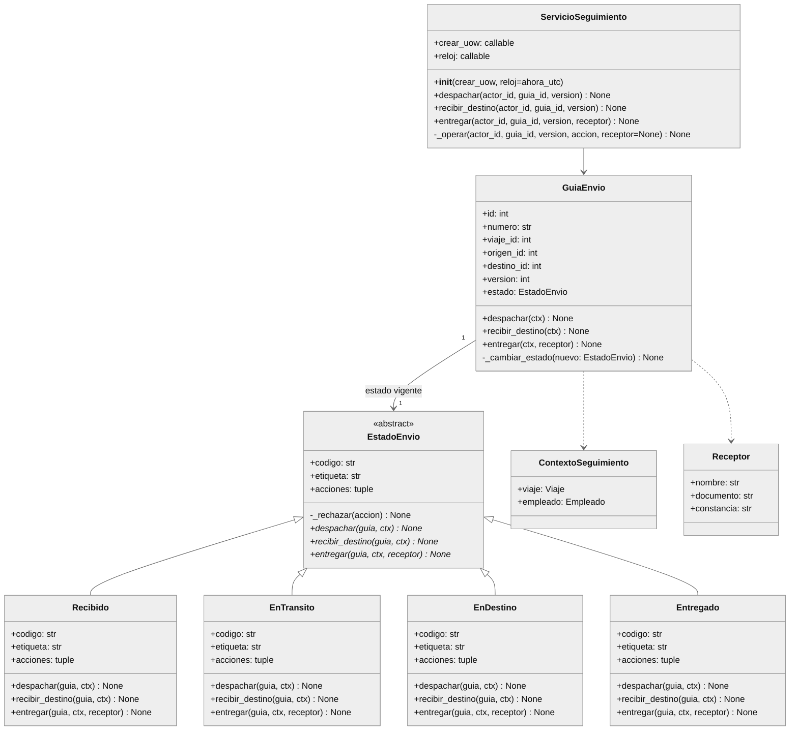
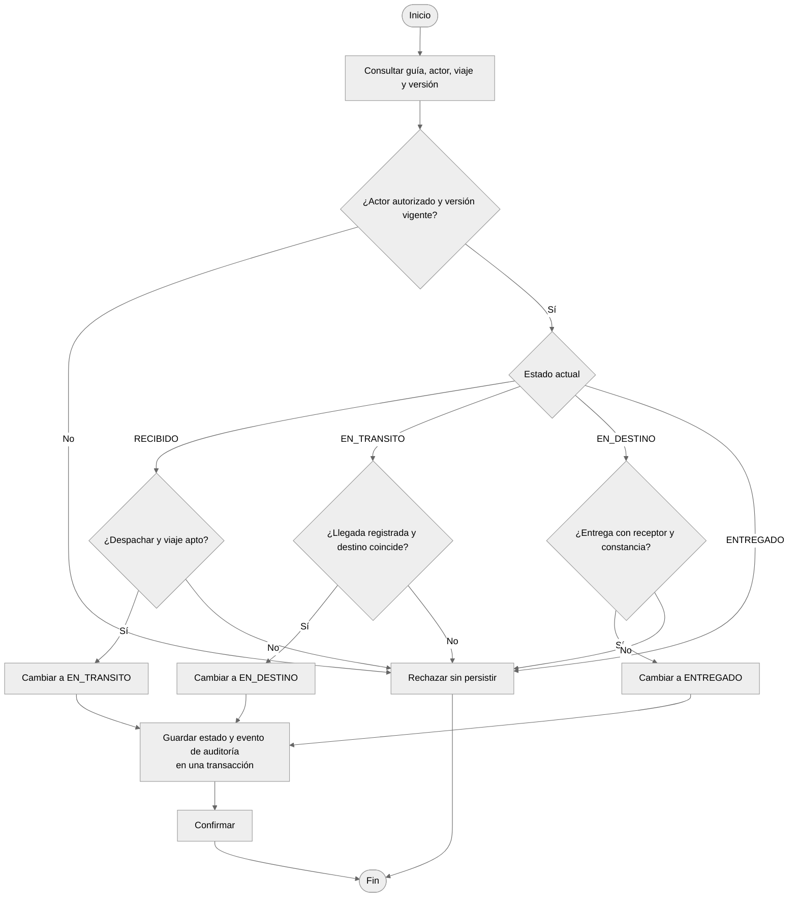
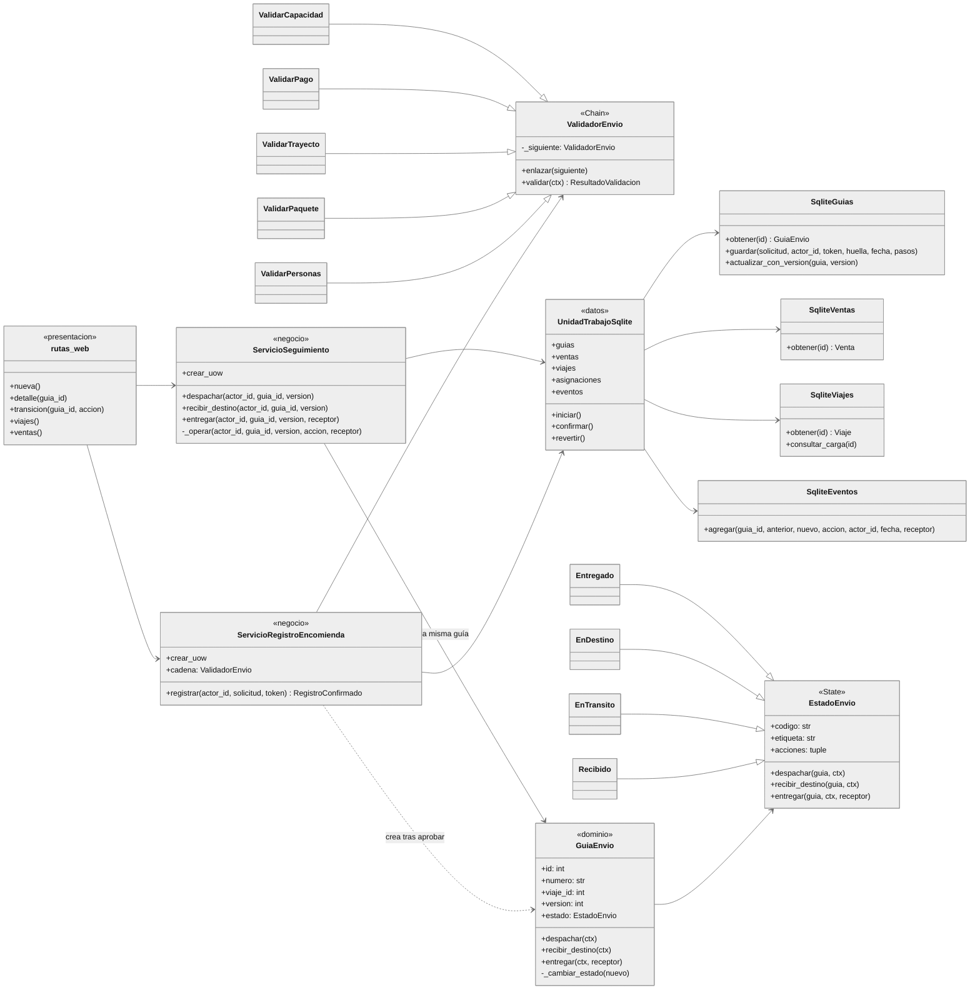

# Diseño UML · Patrones de comportamiento

**Sistema de transportes, pasajeros y encomiendas** — versión integrada Python 3 / Flask / SQLite.  
Diagramas monocromáticos, reproducibles y editables en Mermaid. Dos patrones se implementan en código (**Chain of Responsibility y State**); otros dos se **diseñan, pero no se programan** (**Iterator y Memento**). Los nombres de los diagramas implementados corresponden a las clases reales. Se omiten en las firmas de Python los tipos no anotados.

## 1. Arquitectura de tres capas / tres capas



## 2. Chain of Responsibility — diagrama de clases (IMPLEMENTADO)

Funcionalidad: **validar una encomienda vinculada a venta y viaje**, antes de emitir la guía. La cadena rechaza la primera regla incumplida. No guarda información: lo hace el servicio bajo transacción.



### Diagrama de actividades — Chain of Responsibility



## 3. Iterator — diagrama de clases (SOLO DISEÑO)

Funcionalidad proyectada: **consultar las guías de un viaje mediante un manifiesto**, con dos cursores independientes. Estas clases NO están implementadas y no forman parte de los tests.



### Diagrama de actividades — Iterator

```mermaid
%%{init: {"theme": "neutral"}}%%
flowchart TD
  A([Inicio]) --> B["Verificar actor y viaje"]
  B --> C{¿Autorizado?}
  C -- No --> X["Rechazar consulta"]
  C -- Sí --> D["Consultar guías del viaje"]
  D --> E["Crear instantánea ManifiestoViaje"]
  E --> F["crear_iterador(): posición 0"]
  F --> G{¿hay_siguiente()?}
  G -- Sí --> H["siguiente(): devolver resumen<br/>y avanzar posición"]
  H --> G
  G -- No --> I["Finalizar recorrido sin modificar guías"]
  X --> J([Fin])
  I --> J
```

## 4. Memento — diagrama de clases (SOLO DISEÑO)

Funcionalidad proyectada: **deshacer modificaciones de un borrador de guía**, sin revertir ventas, pagos, seguimiento ni datos persistidos de una guía emitida. Estas clases NO se implementan.



### Diagrama de actividades — Memento



## 5. State — diagrama de clases (IMPLEMENTADO)

Funcionalidad: **seguir la MISMA guía admitida por Chain** mediante acciones; no existe selector libre de estados. Las transiciones autorizadas son `RECIBIDO → EN_TRANSITO → EN_DESTINO → ENTREGADO`.



### Diagrama de actividades — State



## 6. Diagrama de clases INTEGRADO — Chain + State en la misma aplicación

Ambos patrones comparten **`GuiaEnvio`**, `Venta`, `Viaje`, `UnidadTrabajoSqlite` y las vistas Flask; no se implementan como programas separados.



## 7. Observaciones de consistencia

- **Solo dos patrones implementados:** `encomiendas/aplicacion/dominio/cadena.py` y `encomiendas/aplicacion/dominio/estados.py`.
- **Iterator y Memento no están en el código ejecutable:** son diseños propuestos coherentes con las mismas entidades y repositorios.
- **Coexistencia:** la cadena crea la guía en RECIBIDO; State continúa el ciclo de la misma guía, identificada con `id` y `numero`.
- **Capas:** plantilla y controlador HTTP no realizan SQL; los servicios negocian la transacción; repositorios SQLite la almacenan.
- **Primera entrega Java:** se recuperan programación de viajes y registro de pagos mediante `operaciones_anteriores.py`, compartiendo `viajes`, `ventas` y `pagos`. Los patrones creacionales antiguos no se vuelven a implementar en Python, porque el alcance de esta entrega permite implementar solo dos patrones de comportamiento.
- **Evidencia:** grabar pruebas reales de registro rechazado, registro aprobado, transición inválida, despacho, llegada y entrega; las capturas del video deben ser de la aplicación corriendo, no imágenes simuladas.
